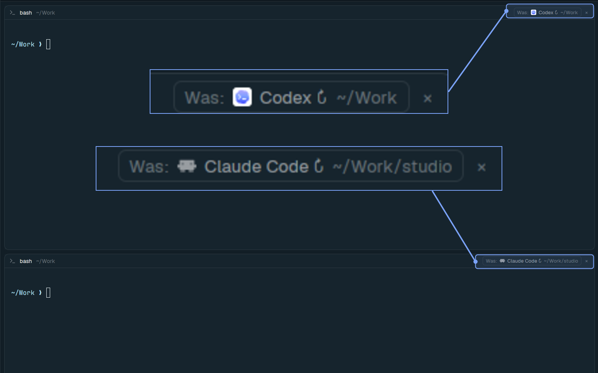

# Where was I?

Shows the last agent that was running in a terminal in the pane header, along with the folder it ran in. Click it to instantly resume. Survives server restarts, reboots, and normal agent exits across local and remote SSH machines.



Point your agent at [RECIPE.md](RECIPE.md) to install, or paste this into an agent inside [Herdr](https://herdr.dev):

```
Read ~/.config/herdr-app/AGENTS.md, then add this mod: github.com/slogonomo/herdr-where-was-i
```
