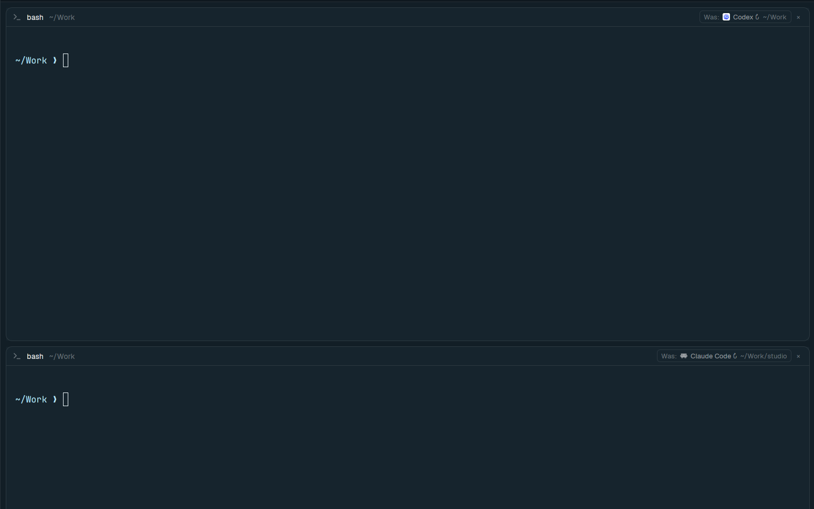

# Where was I?

Shows the last agent that was running in a terminal in the pane header, along with the folder it ran in. Click it to instantly resume. Survives server restarts, reboots, and normal agent exits across local and remote SSH machines.



## What you see

- A 30px pane header bar at the top of each terminal pane (`background`: `t.background`, 1px bottom border in `t.border`, 10px horizontal padding, 8px item gap, 12px text).
- Left side of the header: the active program's 14px icon, its name (`t.foreground`, medium weight, max 260px), and its live working folder shortened to `~` (`t.dim`, flex-1, truncating first).
- Right side when an agent is actively running: the standard agent status indicator (`working` spinner, `Needs you` pill in `t.blocked`, or 7px `done` dot in `t.done`).
- Right side when the terminal is sitting at a plain shell (`bash`, `zsh`, `fish`, etc.) and an agent previously ran in that terminal:
  - A compact resume pill (`20px` tall, `6px` horizontal padding, `5px` gap, `5px` radius, `t.surface` background, `1px` `t.border` border, `11px` text) containing:
    - `Was:` in `t.dim`
    - The previous agent's 12px icon (from `icons/<agent>.svg`, tinted in `t.muted` or full-color depending on the program entry)
    - The previous agent's name followed by ` ↻` in `t.muted` (max 180px, truncated)
    - The folder the agent ran in, shortened to `~`, in `t.dim` (max 160px, truncated; stays `t.dim` on hover)
  - A `20px` tall `×` dismiss button (`4px` horizontal padding, `4px` radius, `11px` text in `t.dim`) beside the pill.
- Far right on pointer hover over the header: four `14px` icon buttons (`split-right`, `split-down`, `zoom`/`unzoom`, `close`).

## How it behaves

- While any recognized coding agent is live and reporting a status (`working`, `blocked`, `done`, or `idle`) in a pane, the mod records the agent's display name, program key, icon path, tint flag, and working directory onto the underlying `herdr-core` terminal via `hc label`:
  - `herdr.last_agent`
  - `herdr.last_key`
  - `herdr.last_icon`
  - `herdr.last_tint`
  - `herdr.last_cwd`
- Because labels are stored on the terminal inside `herdr-core` (including on remote SSH machines), they persist when `herdr-app` closes, when an agent exits back to the shell, and when a kept terminal recovers into a fresh shell after a reboot or server restart.
- When the terminal is at a plain shell—either after a reboot (`p.program.shell === true`) or after exiting an agent (`term.foreground.name` is a shell)—the header switches its left icon and title back to the shell (`zsh`, `bash`, etc.) and displays the `Was: [icon] <Agent> ↻ <folder>` pill.
- Hovering the resume pill highlights its background (`t.hover`), border (`t.accent`), and agent name (`t.foreground`), while keeping `Was:` and the folder path in `t.dim`.
- Clicking the resume pill focuses the pane and types the agent's resume command plus `Enter` directly into the shell via `hc keys` (`claude --continue`, `codex resume`, `opencode --continue`, `agy`, `gemini`, `pi`, `cursor-agent`, `aider`). Once the agent starts and reports status again, the `Was:` pill disappears and normal agent status indicators take over.
- Clicking `×` clears the `herdr.last_*` labels on that terminal so the pill disappears and the pane stays a plain shell.
- No keys are added or changed.

## Built from

- A clone of the user's active layout (for example `main`) with the active tab block's pane header pointed at `where-was-i`:
  ```json
  "header": {
    "content": { "mod": "where-was-i" },
    "height": 30,
    "position": "top",
    "reveal": "always"
  }
  ```
- One mod, `mods/where-was-i/`, cloned from the shipped `pane` mod (`mod.json`: `{ "place": "none", "title": "Where was I?" }`), with `main.js` and the five pane control SVGs (`split-right.svg`, `split-down.svg`, `zoom.svg`, `unzoom.svg`, `close.svg`).
- `herdr` imports: `panes`, `terminals`, `props`, `run`, `hc`, `theme`, `home`.
- Program calls:
  - `hc(["label", terminal, ...])` to persist or clear `herdr.last_*` labels on the terminal.
  - `hc(["keys", terminal, ...keys, "enter"])` to type the resume command directly into the shell without `<hc from="...">` message tags.
- Shipped agent icons in `icons/` (`icons/claude.svg`, `icons/codex.svg`, `icons/antigravity.svg`, `icons/opencode.svg`, `icons/gemini.svg`, `icons/pi.svg`, `icons/cursor.svg`, `icons/shell.svg`, `icons/agent.svg`).
- No network requests, no background timers, and no external scripts or agent hooks.

## Watch out

- When an OSC 7501 agent exits normally back to the shell inside an existing terminal, `p.program.agent` can remain `true`, `p.program.shell` can remain `false`, and `p.status` can even stay `"idle"` from the terminal's last OSC 7501 report, while `term.foreground.name` returns to the shell (`bash`, `zsh`, etc.). Check both `p.program.shell` and `SHELL_NAMES.has(fgName)` so the header resets to the shell icon/name and shows the `Was:` pill immediately on agent exit as well as after a reboot.
- Do not use `hc send` to run the resume command in a plain shell: `hc send` wraps the text in `<hc from="...">...</hc>`, which causes a syntax error in `bash`/`zsh`. Use `hc keys <terminal> <characters...> enter` (converting spaces to `"space"`) so the shell receives plain keystrokes.
- Only call `hc(["label", ...])` when the active agent's `(terminal, name, key, icon, tint, cwd)` signature actually changes (`this.lastSavedKey !== sig`), never on every render.
- `home()` returns the local machine's home directory (`/home/<user>` on Linux vs `/Users/<user>` on macOS). When formatting `cwd` and `herdr.last_cwd` for remote SSH machines, also collapse `/^\/(?:home|Users)\/[^/]+(\/.*)?$/` to `~` so remote paths shorten cleanly and don't leak usernames.
- Resuming depends on the shell's working directory for agents like Claude Code and Codex. Showing `herdr.last_cwd` inside the pill lets the user see if they `cd`'d to another directory before clicking resume, without forcibly changing their shell's directory.

## Done when

- `herdr-app check ~/.config/herdr-app/mods/where-was-i` passes and `herdr-app status` reports no errors.
- Starting an agent (such as Claude Code or Codex) in a pane writes `herdr.last_agent`, `herdr.last_key`, `herdr.last_icon`, `herdr.last_tint`, and `herdr.last_cwd` on that terminal (`hc get <terminal>`).
- Exiting the agent back to the shell (or restarting `herdr-core`) switches the pane header back to the shell name/icon and displays `Was: [icon] <Agent> ↻ <folder>` with the `×` button.
- Clicking `Was: [icon] <Agent> ↻ <folder>` types the resume command into the shell and launches the agent without `<hc from=...>` tags.
- Clicking `×` removes the `herdr.last_*` labels and hides the pill.
